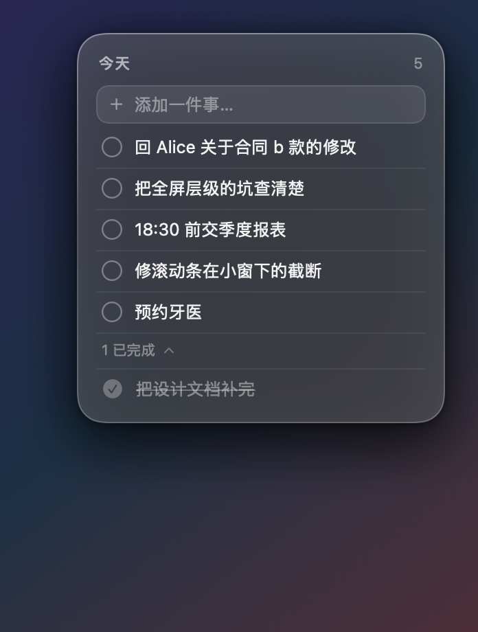

# utodo

桌面右上角的一张玻璃待办卡，加上一个能直接写库的 `utodo` 命令行。给 agent 用：agent 往命令行里塞一条待办，1 秒内就出现在屏幕上，不用切窗口。



- 常驻桌面，不抢焦点、不弹通知、没有 Dock 图标
- 一屏最多 5 条未完成，多了滚动；已完成折叠在底部，可以逐条删或一次清空
- 切到全屏应用时整张卡自动变淡（alpha 0.55），鼠标移上去或开始输入就恢复
- `⌥Space` 在任何 App 里把卡片叫到前台并聚焦输入框；点别处或按 Esc，键盘立刻还给原来的 App，没输入完的草稿还在

## 安装

要求 macOS 26+ (Apple Silicon)，以及 Xcode（命令行工具链自带 Swift 就行，但 Swift Testing 需要 Xcode 的 Developer 目录）。

```bash
git clone https://github.com/AZEROSTART/utodo.git
cd utodo
./Scripts/install.sh
```

装到两个地方，不需要 sudo：

- `~/Applications/UTodo.app`
- `~/.local/bin/utodo`

如果需要让 `utodo` 全局可用，把下面这行加进 `~/.zshrc`：

```bash
export PATH="$HOME/.local/bin:$PATH"
```

启动：`open ~/Applications/UTodo.app`

## 命令行

```bash
utodo add "回 Alice 邮件"       # 新增一条
utodo add -                    # 从 stdin 读，每行一条（首行排最上）
utodo list                     # 列出未完成，格式：短id  标题
utodo list --json              # JSON 数组，含 created_at / completed_at
utodo done a1b2c3d4            # 短 id 前缀匹配，唯一即可
utodo rm a1b2c3d4              # 删除
utodo clear                    # 清除全部已完成，输出「已清除 N 条」
utodo --version
```

退出码：`0` 成功 / `1` 没找到或前缀有歧义 / `2` 用法错误。

CLI 和 App 直接读写同一个 SQLite 文件（`~/Library/Application Support/utodo/utodo.sqlite3`，WAL 模式），写完发一个本地通知让卡片刷新。`UTODO_DB` 环境变量可以覆盖数据库路径（测试用）。

## 登录项

从 `~/Applications/UTodo.app` 首次启动时，App 会尝试用 `SMAppService.mainApp` 把自己加进登录项。如果系统拒绝（比如签名不受信任），自动尝试会静默失败，手动加一次就行：

- 系统设置 → 通用 → 登录项与扩展 → 「登录时打开」→ `+` → 选 `~/Applications/UTodo.app`

开发时从 `build/UTodo.app` 启动不会注册登录项，避免把临时路径写进系统。

## 交互

| 操作 | 结果 |
| --- | --- |
| `⌥Space` | 卡片获得焦点，光标在输入行 |
| 输入后回车 | 新待办出现在最上面；空输入直接忽略 |
| 点左边的圈或标题 | 标记完成（点圈心也算，不用点在那圈细线上） |
| 悬停某行 | 右侧浮出删除 |
| 点底部「N 已完成」 | 展开已完成，可逐条删 |
| 右键卡片 | 添加 / 显示已完成 / 清除已完成 / 退出 |
| 拖动卡片 | 位置记住，换屏也跟着走；屏幕拔了退回主屏 |
| Esc 或点别的 App | 输入行收起，文字保留，键盘归还 |

## 开发

```bash
export DEVELOPER_DIR=/Applications/Xcode.app/Contents/Developer
swift test -j 1                                    # 只链一个，并行链接偶发失败
swift build --product utodo                        # CLI 在 .build/debug/utodo
./Scripts/build-app.sh                             # App 在 build/UTodo.app
./Scripts/cli-smoke.sh .build/debug/utodo          # CLI 冒烟
./build/UTodo.app/Contents/MacOS/UTodo --render-preview /tmp/preview.png   # 离屏渲染卡片
```

`--render-preview` 不需要屏幕录制权限，用于在没有截图权限的环境里检查界面。

## 已知限制

- 只支持 macOS 26+，只在 Apple Silicon 上验证过
- 不申请任何系统权限（辅助功能、输入监控、屏幕录制都没有）；`⌥Space` 用的是 Carbon `RegisterEventHotKey`
- 全屏检测靠窗口层级和尺寸，普通窗口铺满整块屏（无边框全屏窗口）会被当成全屏
- 数据库文件损坏（文件头不是 SQLite）时，原文件会被改名成 `utodo.sqlite3-corrupt-<时间戳>` 留证，App 重建空库继续跑；其他数据库错误（被占用、只读、磁盘满）会如实报错，不动文件
